# AndroMac guide

This guide walks through installing and pairing, then covers each feature and setting and what to
do when something does not work. Türkçe: [GUIDE.tr.md](GUIDE.tr.md).

## Install

The packages are on the [releases page](https://github.com/anilmetin0/AndroMac/releases/latest),
with their checksums in `SHA256SUMS.txt`. The Mac app runs on Apple Silicon (M1 and later) only.
The same APK works on every Android phone.

### Mac, macOS 14 Sonoma or later

With [Homebrew](https://brew.sh). The tap lives in this repository, so it is added by URL and
Homebrew asks you to trust it:

```bash
brew tap anilmetin0/andromac https://github.com/anilmetin0/AndroMac
brew trust anilmetin0/andromac
brew install --cask andromac    # or andromac@nightly for the newest build
xattr -dr com.apple.quarantine /Applications/AndroMac.app
```

Without Homebrew, download `AndroMac-<version>-macOS-arm64.dmg`, open it, drag `AndroMac.app` to
**Applications**, and run the `xattr` line above.

The app is not notarized by Apple, so macOS blocks the first launch. The `xattr` line fixes that
once. You can also open the app, let macOS refuse it, and press **Open Anyway** in **System
Settings → Privacy & Security**.

On first launch:

1. Answer **Always Allow** to the Keychain prompt. If you decline, the app still runs and the panel
   tells you it is using a temporary key.
2. Answer **Allow** to the Local Network prompt. Without it the phone cannot find the Mac.
   The [welcome window](#first-launch) asks for it too.
3. AndroMac lives in the menu bar, not the Dock. Click the phone icon to open the panel.
4. Optional: Settings → General → **Open at login**.

### Android 10 or later

On the phone, open the [releases page](https://github.com/anilmetin0/AndroMac/releases/latest),
tap `AndroMac-<version>-android.apk`, and allow installs from your browser when Android asks.

From a Mac, with the phone connected over adb and [GitHub CLI](https://cli.github.com) installed:

```bash
gh release download --repo anilmetin0/AndroMac --pattern '*-android.apk'
adb install AndroMac-*-android.apk
```

Then open AndroMac. The [setup](#first-launch) walks you through the permissions:

1. While a required permission is missing, a card at the top of the main screen names it. Tap a
   line to open the right system screen. The cross hides the card until something else goes
   missing. The full list is in Settings → Permissions, grouped as Required, Recommended and
   Optional:
   - **Local network access**, required on Android 17 and later. Without it the phone cannot find
     or reach the Mac. Android lists it under Nearby devices.
   - **AndroMac notifications**, required on Android 13 and later, for the app's own
     notifications.
   - **Notification access**, required, for notification mirroring and music info.
   - **Unrestricted battery**, recommended, so Android does not cut the connection while the
     screen is off.
   - **Calls on your Mac**, optional, the Nearby devices permission that lets the phone pair with
     the Mac over Bluetooth for [calls](#bluetooth-calls). Android 12 and later.
   - **Do Not Disturb access**, optional, so the Mac can silence the phone.
   - **Display over other apps**, optional, so the Mac can fetch the phone's clipboard without
     you tapping a notification first.
2. On Android 13 and later the notification access switch is greyed out for apps installed from a
   file. Try it once, then go to **Settings → Apps → AndroMac → ⋮ → Allow restricted settings**
   and try again.

[Obtainium](https://github.com/ImranR98/Obtainium) can install and update the APK from the
releases page. Add `https://github.com/anilmetin0/AndroMac` as an app, or open
[obtainium://add/github.com/anilmetin0/AndroMac](obtainium://add/https://github.com/anilmetin0/AndroMac)
on the phone. Obtainium follows stable releases. For nightly builds, turn on **Nightly builds** in
the app's update settings instead.

### First launch

Each app opens a short setup once, when it has no pairing yet. **Skip** leaves it at any step, and
the permissions you skipped stay in Settings.

On the Mac, a welcome window opens in the middle of the screen. It goes through **Allow access**
(Notifications, Local Network, and Bluetooth and Microphone for calls),
**Connect your phone**, **Calls on your Mac** and a summary. **Allow** on a row either asks
for the permission or opens the matching System Settings pane. Open it again with Settings →
General → **Show welcome again**.

On the phone, the setup goes through a welcome, **Required permissions**, **Recommended** and
**Optional** (Calls on your Mac, Do Not Disturb access, Display over other apps), then **Connect to
your Mac**. A step whose permissions are all granted is skipped. Open it again with Settings →
Help → **Setup guide**.

### Updates

Both apps check for updates once a day and can install them on their own. **Settings → Updates**
on either side has the check switch, **Install updates automatically** and **Nightly builds**. The
Mac also has **Check now**. On the phone one button checks, downloads or installs, depending on
what is pending. A new version is offered with **Install now**, **Later** and **Skip this
version**.

Before installing, the app checks the download against the `SHA256SUMS.txt` published with the
release and stops if it does not match. The Mac replaces itself and restarts. On the phone,
Android's installer asks you to confirm. A Mac installed with Homebrew updates through
`brew upgrade`.

The update check and the download go to GitHub. Everything else stays between your phone and
your Mac. Turn the check off in Settings → Updates if you prefer to update by hand.

## Pairing

1. Open AndroMac on the Mac. Make sure the phone and the Mac are on the same Wi-Fi network.
2. Tap **Pair** on the phone. It lists the Macs it finds on the network, each with its name and IP
   address. Pick yours. If yours is missing, tap **Search again**.
3. The Mac's pairing window shows the phone's IP address. Both screens show the same
   6 digits. If they match, confirm on both. If they do not match, reject.

After that the phone reconnects on its own whenever the network comes back.

While unpaired, both apps show a short checklist so you can see which step is stuck:

| Step | On the phone | On the Mac |
|---|---|---|
| Is the app open on the Mac | `Mac seen on the network` or `not found` | `This Mac is visible on the network` |
| Same network | `Phone: 192.168.1.42` | `This Mac: 192.168.1.5` |
| Pair | `Ready` or `Finish the steps above` | Waiting for the phone |

If it still does not connect, **I can't connect** at the bottom of the checklist opens a live
diagnostics screen: the phone's address, whether the Mac was seen, the connection state, the app
version, and fixes for common problems. Settings → Advanced on the Mac shows the Mac's address and the Bonjour service.

On the Mac, the pairing window always starts on **Reject**, so a phone can only pair after you
click **Pair**.

### Several Macs

A phone can be paired with more than one Mac. Pair each one the same way. Settings → Connection
on the phone lists the saved Macs. Tap one to switch to it.

### Disconnecting

To take the phone off the Mac for a while, tap **Disconnect** in the AndroMac notification, in
Settings → Connection, or on the AndroMac connection tile in Quick Settings. The phone stays
disconnected until you tap **Connect** again. On the Mac, **Disconnect** is in the phone's
**⋯** menu in the panel.

Disconnect turns **Connect automatically** off. It is one switch on both sides: the Mac has it per
phone in the **⋯** menu and in Settings → Devices. A change on one side reaches the other right
away while they are connected, otherwise the next time they connect. With it off, the phone
connects only when you tap **Connect** on it, so after turning it back on at the Mac, tap
**Connect** on the phone once.

## Features

| Feature | Direction | What it does |
|---|---|---|
| Battery | Phone to Mac | Level, charging state and temperature. Optional percentage in the menu bar, and a warning when the level drops below the threshold you set in Settings → Devices. |
| Clipboard | Mac to phone | Sent as you copy (the settings button on the Clipboard page), or by hand with Send to phone in the clipboard history. If the phone cannot write to the clipboard in the background, it shows a notification with a Paste button. Text that a password manager marks as hidden is never sent. |
| Clipboard | Phone to Mac | The Mac asks for it when you open the panel. The phone also sends it whenever you open AndroMac on the phone. You can send it yourself with the Quick Settings tile, the notification button, or the share sheet. See [why it works this way](#why-the-phone-clipboard-is-fetched). |
| Clipboard history | Mac | The last 50 entries from both sides. Search, click to copy, right-click to send back to the phone or delete. |
| Notifications | Phone to Mac | They show up in Notification Center with the app's own icon. You can use their actions, including inline reply, from the Mac. Dismissing on one device dismisses on the other. |
| Per-app setting | Both ways | Full, Title only, or Off, set from either device. Off sends nothing for that app. Title only sends the app name without the text. |
| Filtering | Phone | Group summaries, ongoing notifications and silent ones are skipped. Mirroring can be limited to when the phone is locked. |
| Notification history | Mac | The last 200 entries, searchable, kept only on the Mac. |
| Media | Both ways | Title, artist and app of what is playing on the phone, with previous, play/pause and next on the Mac. |
| Find my phone | Mac to phone | The phone rings at alarm volume and vibrates for up to 30 seconds. Found it, a second press, or the timeout stops it. |
| Phone controls | Mac to phone | Ringer (ring, vibrate, silent) and media volume from the panel, plus a test notification. Silencing needs Do Not Disturb access on the phone. |
| Files | Both ways | Share from the phone's share sheet, or drop files onto the Mac panel. The receiver is asked first, unless you turn on auto-accept. Files go to Downloads, are checked when they arrive, and are never opened for you. |
| Messages | Both ways | SMS conversations on the Messages page of the Mac's window (⌘⇧M, or the message button on the phone's card): the 50 most recent conversations, the last 200 texts of each, replies and new texts sent through the phone. SMS only, no MMS, RCS or chat apps. Off until you turn it on in the phone's Settings → Messages. Nothing is stored on the Mac. |
| Several phones | Mac | More than one phone can be connected at once. The panel shows them as tabs. Each one can be disconnected on its own and has its own clipboard switch. Settings → Devices lists every phone with its IP address and when it was last seen, and is where you forget one. |
| Several Macs | Phone | A phone can remember more than one Mac and switch between them in Settings → Connection. |
| Verification codes | Mac | When a notification contains a one-time code, the Mac notification gets Copy code and the panel shows a copy button for it. A code needs a word such as code, OTP, kod or şifre near it. Copied codes do not go into the clipboard history. |
| Metrics | Mac | Messages per hour, traffic, reconnects and the most common message types. |
| Screen mirroring | Phone to Mac | The phone's screen in a window, with mouse, keyboard and sound, over Wireless debugging or USB. See [Screen mirroring](#screen-mirroring). |
| Updates | Both | Each app checks once a day and installs updates itself. See [Updates](#updates). |

Not included: MMS, RCS and access over the internet. LAN sync needs the phone and Mac on the same
local network. Bluetooth call control is separate and needs the phone paired with the Mac over Bluetooth.

### Send files from the Mac

In Finder, select up to 50 files, right-click and choose **Share → AndroMac**. Choose the phone
in AndroMac and click **Send**. If the share target is hidden, enable AndroMac under
**System Settings → General → Login Items & Extensions → Sharing** (the location varies by macOS version).

For a quick send, drag files to the top edge of the screen or onto AndroMac's menu bar icon.
Drop them on **Send to Android**. The target names the phone currently selected in the panel;
dropping sends immediately to that phone. With no connected phone it cannot accept a drop.
The existing panel drop and file picker also work. Folders and files larger than 4 GiB cannot be sent.
The phone still asks before receiving unless its **Accept files automatically** setting is on.

### Bluetooth calls

The Mac handles calls over Bluetooth, so the phone has to be paired with it once. AndroMac can do
that for you:

1. On the phone, allow **Calls on your Mac** (Nearby devices) in Settings → Features or Settings →
   Permissions.
2. On the Mac, open **Settings → Calls** and click **Pair** next to the phone. The button shows
   while the phone is connected to AndroMac and its app version supports it. The welcome window has
   the same button.
3. The phone shows a notification naming your Mac. Tap it: the phone starts the Bluetooth pairing,
   asking for Nearby devices first if needed. Both screens show the same code; confirm it on both.
   The Mac then connects calls by itself.

Nothing pairs until you tap that notification, so a Mac cannot pair the phone with something else.
Pairing gives up after two minutes. To pair by hand instead, pair the phone in macOS Bluetooth settings
(**Bluetooth settings…** in Settings → Calls opens them), click **Refresh**, choose the phone and
click **Connect**.

Incoming calls appear in the panel and in Notification Center, with **Answer** and **Decline**.
During a call, use **End call**, **Use Mac audio** or **Use phone audio**.

Mac audio needs microphone permission and a working Bluetooth SCO audio channel. Some macOS
and phone combinations reject this channel even when call control connects. AndroMac reports
the failure and returns audio to the phone. Two-way microphone and speaker audio needs a hardware
test on your Mac and phone; a connected call-control session alone does not prove it works.

### Screen mirroring

The Mac can show the phone's screen in a window and pass the mouse, the keyboard and the sound
through. This uses [scrcpy](https://github.com/Genymobile/scrcpy), which comes with the Mac app together
with adb. It runs over Android's debugging connection, so you need to turn on one setting on the
phone yourself:

1. On the phone, unlock Developer options by tapping **Build number** seven times, then turn on
   **Wireless debugging**. A USB cable with USB debugging on works too.
2. Press the mirror button on the phone's card in the Mac panel. The first time, the panel asks
   for a pairing code. On the phone open Wireless debugging, then **Pair device with pairing
   code**, and type the six digits into the panel. You do this once per Mac.
3. The phone's screen opens in a window. Close the window to stop.

While Wireless debugging is off the panel says so, and **Open on phone** opens that setting on
the phone. Once it is on, the Mac continues by itself. Settings → Screen mirroring has sound, turning the
phone's screen off, keeping it awake, and a resolution limit.

Wireless debugging lets any computer the phone has trusted before control it, so turn it off when
you are done. A build from source without the bundled copy uses `brew install scrcpy`. What is
bundled, and under which licenses, is in [THIRD-PARTY-NOTICES.md](../THIRD-PARTY-NOTICES.md).

### Why the phone clipboard is fetched

Since Android 10, an app can only read the clipboard while it is on screen. So the phone does not
send its clipboard on its own; the Mac asks for it when you open the panel. The phone then reads
it by opening an invisible screen for a moment. It also sends the clipboard whenever you open
AndroMac on the phone.

That invisible screen needs **Display over other apps** on the phone. Without it the phone shows a
notification with a "Send clipboard" button instead, and the tile and the share sheet still work.

## Settings

### On the phone

The main screen shows which Mac the phone is connected to, the four sync switches for
**Battery**, **Clipboard**, **Notifications** and **Media**, and the clipboard history. The
pairing checklist shows until the phone is paired. After that, the **ⓘ** button in the top bar
opens it with the live diagnostics. Everything else is under **Settings** in the top bar.

The version appears as `1.1.0 (12 · abc1234)`: version, build number and commit. It is in
Settings → Help → About. Copy the whole string into bug reports.

| Screen | What is on it |
|---|---|
| Settings | **Connection** at the top. **Features**: Notifications, Clipboard, the **Media** and **Battery** switches, File transfer, Messages and Calls on your Mac. **App**: Permissions, Language (Android 13 and later) and Updates. **Help**: Setup guide, Connection help and About. At the bottom, **Reset AndroMac** erases the pairings, all settings and the clipboard history, after asking first. |
| Clipboard history | The last 20 texts sent to or received from the Mac. Tap to copy, or tap the send button to send again. Kept in memory only; sensitive clips are not saved. |
| Permissions | Every permission this Android version has, grouped as Required, Recommended and Optional, each marked granted or with an **Allow** button. Tap one to open the system screen for it. |
| Connection | The connection state, the saved Macs with their last address, **Connect automatically**, **Connect** or **Disconnect**, and **Forget this Mac**. |
| Notification settings | **App filter**, **Silent notifications**, and **Only while the phone is locked**, plus a list of what is always skipped. |
| App filter | Full, Title only or Off for every app the phone has seen. |
| Clipboard settings | Incoming: **Write to the clipboard**, **Show a notification**. Outgoing: **Never send sensitive content**. Plus **Send clipboard to Mac**. |
| Connection help | Live diagnostics and common problems. Open it with the **ⓘ** button or **I can't connect**. |
| Updates | See [Updates](#updates). |
| File transfer | **Receive files from the Mac** and **Accept files automatically**. Files go to Downloads. To send, use any app's share sheet. |
| Messages | Turns Messages on the Mac on or off (off by default) and asks for SMS access. Contacts access is optional and only puts names to numbers. |
| Calls on your Mac | Asks for Nearby devices. Once it is allowed, the row opens Android's Bluetooth settings. See [Bluetooth calls](#bluetooth-calls). |
| Setup guide | The first-launch setup again. See [First launch](#first-launch). |
| Language | Android's per-app language picker, with English and Turkish. |

### On the Mac

The menu bar panel gives you a quick look. With more than one phone paired, tabs at the top
switch between them. The phone's card shows its name and state, the battery, what is playing, and
the ringer and volume. Below it are buttons to ring the phone, send a test notification, and
mirror the screen, and a **⋯** menu with **Send my clipboard here**, **Connect automatically**,
**Device settings…**, **Disconnect** and **Forget…**. Next come the last clipboard entry and the four latest notifications. Drop files
onto the panel to send them. ⌘, opens Settings. Right-click the menu bar icon for Open AndroMac,
Settings and Quit. ⌘Q closes the windows like ⌘W and AndroMac keeps running in the menu bar;
to quit, use Quit there or the power button in the panel.

The window has a sidebar with **Messages**, **Notifications**, **Clipboard** and **Apps** at the
top, followed by the settings pages. On Notifications and Clipboard, the settings button in the
toolbar (⌥⌘I) opens that page's settings beside the list.

| Page | What is on it |
|---|---|
| Messages | The phone's SMS conversations on the left, the open one on the right. ⌘N starts a new text, ⌘⇧M opens the page from anywhere. |
| Notifications | Notification history, with search and a clear button. Its settings: **Mirror notifications**, **Play a sound for mirrored notifications**, and the number of entries in the history. |
| Clipboard | Clipboard history. Click to copy, right-click to send back or delete. Its settings: **Sync clipboard**, whether the Mac's clipboard is sent automatically or by hand, **Never send a concealed clipboard**, and whether opening the panel fetches the phone's clipboard. |
| Apps | Full, Title only or Off for every app on the phone. |
| General | **Open at login**, **Show battery percentage in the menu bar**, and **Language** (System, English, Turkish; needs a restart). The app version, and **Show welcome again**. **Reset AndroMac…** erases the paired phones, both histories, every setting and this Mac's key, then restarts. Every phone has to pair again. |
| Devices | This Mac's name, then every paired phone with its status, local IP address and when it was last seen, **Connect automatically** and **Forget**. **Battery and media** has the switches for the phone's battery and what is playing, the low-battery alert and its threshold (10, 15, 20 or 30 percent). A QR code for the releases page installs the APK on the phone. |
| Files | **Receive files** and **Accept files automatically**. |
| Calls | **Pair** for the connected phone, then the Bluetooth phone, **Bluetooth settings…**, **Refresh** and **Connect**. See [Bluetooth calls](#bluetooth-calls). |
| Screen mirroring | Sound, phone screen off, stay awake, resolution limit. |
| Permissions | Notifications, Local Network, Bluetooth, Microphone and Keychain access, each with a button to the right System Settings pane. |
| Updates | See [Updates](#updates). |
| Advanced | The privacy note: everything stays on your local network, encrypted, and the optional update check is the only exception. **Network** has the Mac's address, the Bonjour service and a shortcut to the Local Network permission. **Metrics** has messages per hour, traffic and reconnects for each phone. |

## Troubleshooting

| Problem | What to check |
|---|---|
| The phone does not find the Mac | AndroMac is open on the Mac. Both devices are on the same Wi-Fi, not a guest network or one with client isolation. The Mac has the Local Network permission (Settings → Permissions). On Android 17 and later, the phone has Local network access. |
| It connects, then drops | Battery optimization exemption on the phone, and AP isolation on the router. |
| Notifications do not arrive | Notification access on the phone, including the Android 13+ restricted settings step. The app may be set to Off. Silent notifications are not sent by default. If macOS notifications are off for AndroMac, the panel tells you. |
| The phone warns that the Mac's key changed | Normal if you reinstalled the Mac app: forget the Mac on the phone and pair again. If you did not reinstall anything, reject it. A reinstalled phone shows up on the Mac as a new device; forget the old entry in Settings → Devices. |
| The Keychain asks again after an update | Release builds are not signed with an Apple Developer ID, so the Keychain may ask once per update. Answer **Always Allow**. |
| The phone's clipboard does not reach the Mac by itself | That is the Android limit [described above](#why-the-phone-clipboard-is-fetched). Open the Mac panel, or open AndroMac on the phone. Granting **Display over other apps** makes it work without a tap. |
| Silencing the phone from the Mac does nothing | Grant **Do Not Disturb access** on the phone. |
| Screen mirroring asks for Wireless debugging | Turn on **Wireless debugging** in Developer options with the phone on the same Wi-Fi, or connect a USB cable with USB debugging on. The first time, type the code from **Pair device with pairing code** into the panel. |
| No track shows on the Mac while music plays | Grant notification access on the phone, and check that the Media switch is on. |

**I can't connect** on the phone checks most of these for you while the phone is unpaired.

## How pairing and security work

When you pair, the phone and the Mac exchange keys, and both screens show a 6-digit code made
from that exchange. If the codes match, nobody got in between. Each side then remembers the
other's key. Later connections are encrypted with these keys, and a device whose key does not
match is refused. If a saved key changes, AndroMac warns you instead of accepting it.

What goes where:

- Sync data goes straight between the phone and the Mac on your local network. Only the update
  check and update downloads go to GitHub.
- For each app, the notification setting decides what leaves the phone: everything (Full), only
  the app name (Title only), or nothing (Off). Clipboard text marked as sensitive, for example by
  a password manager, is not sent.
- Notification and clipboard history is stored encrypted, and only on the Mac. Forget all devices
  or reset AndroMac to delete it.
- A file is saved only after the receiver accepts it or turns on auto-accept. It is checked when
  it arrives and never opened automatically.

The technical details are in [PROTOCOL.md](PROTOCOL.md). Report security problems privately as
described in [SECURITY.md](../SECURITY.md), not in a public issue.

## Battery use

The Mac does the work of keeping the connection alive, so the phone mostly waits. When idle,
Settings → Advanced → Metrics on the Mac should show about 30 messages per hour for each phone. If it shows
many more, something is wrong; please open an issue. The details are in [ENERGY.md](ENERGY.md).

## Screenshots

<table>
<tr>
<td align="center">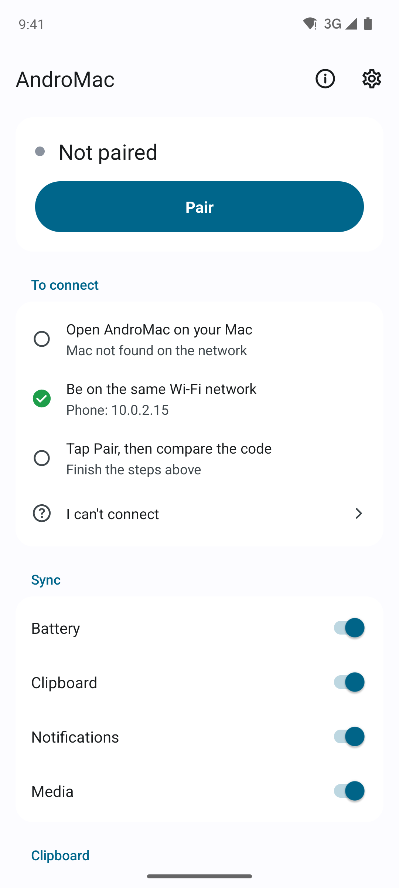</td>
<td align="center">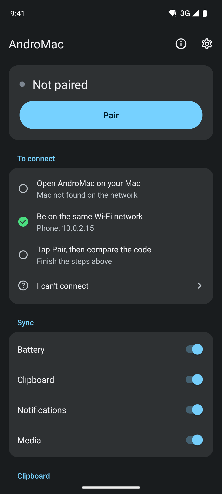</td>
<td align="center">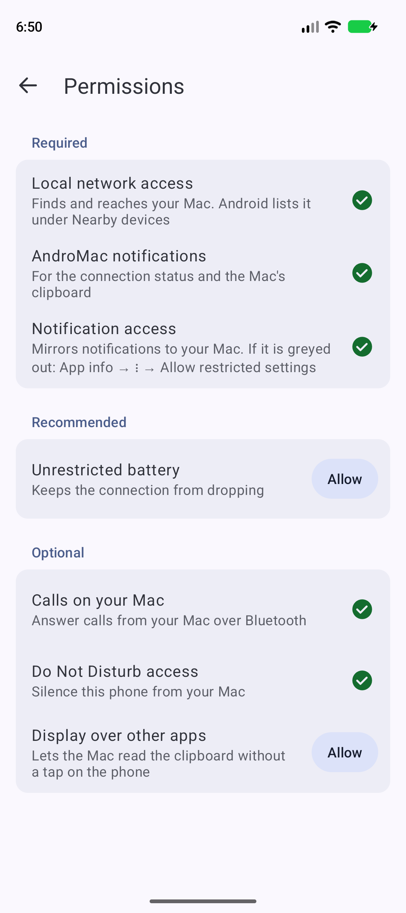</td>
<td align="center">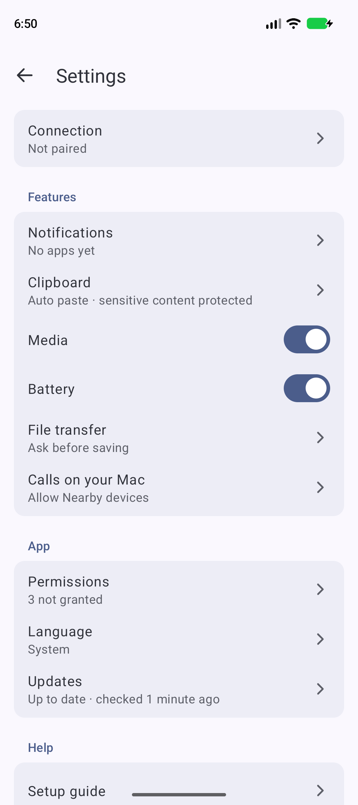</td>
</tr>
<tr>
<td colspan="2" align="center">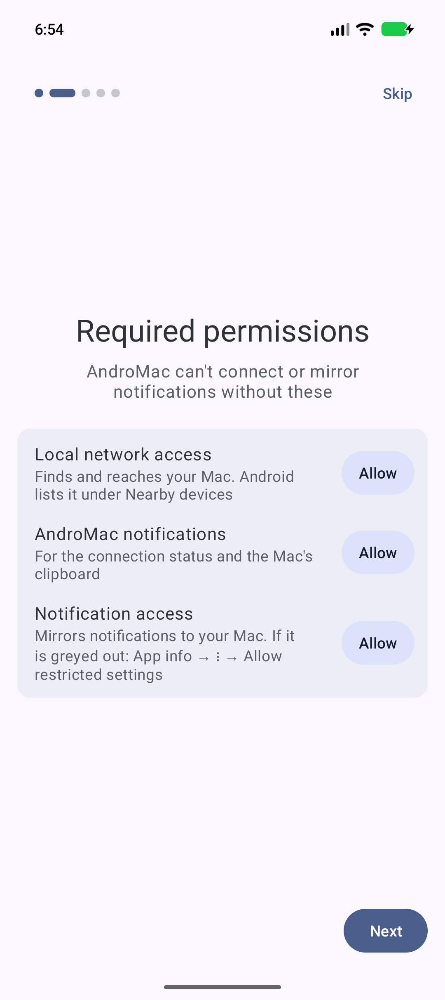</td>
<td colspan="2" align="center">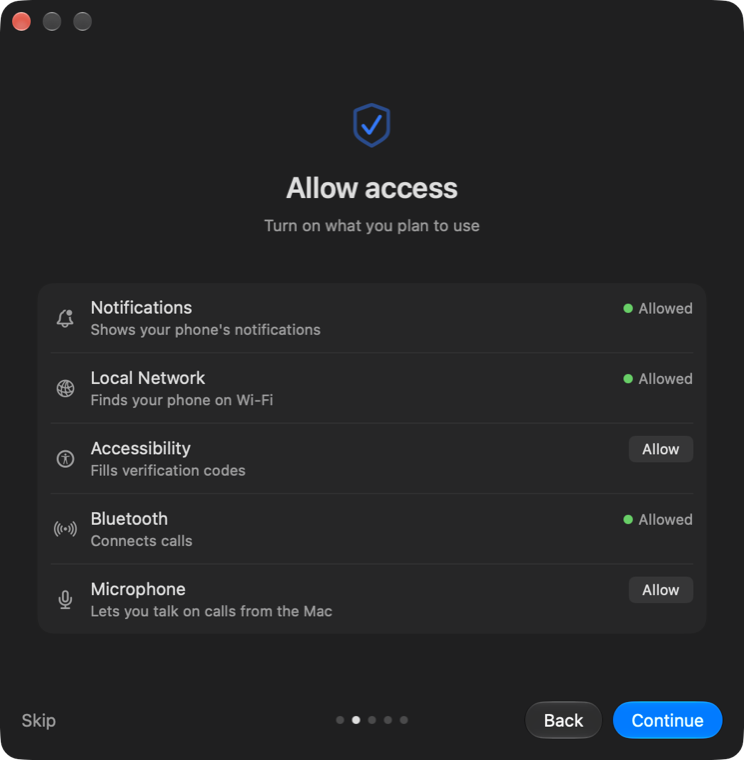</td>
</tr>
<tr>
<td colspan="2" align="center">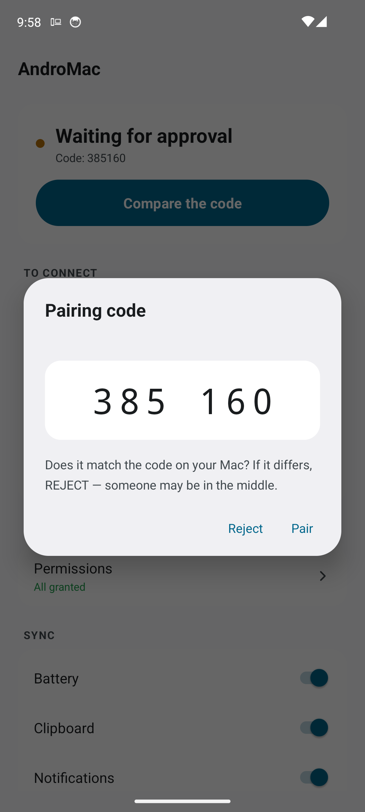</td>
<td colspan="2" align="center">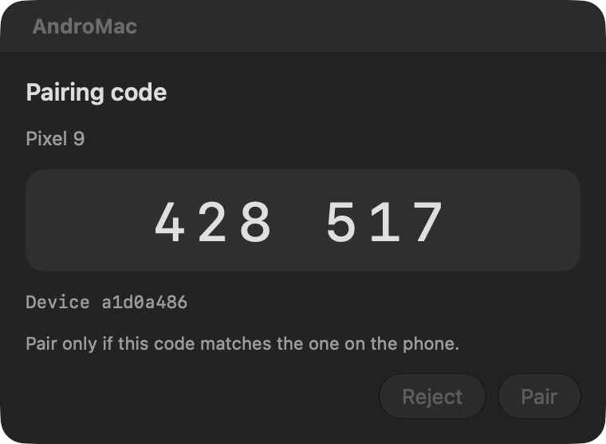</td>
</tr>
<tr>
<td colspan="4" align="center">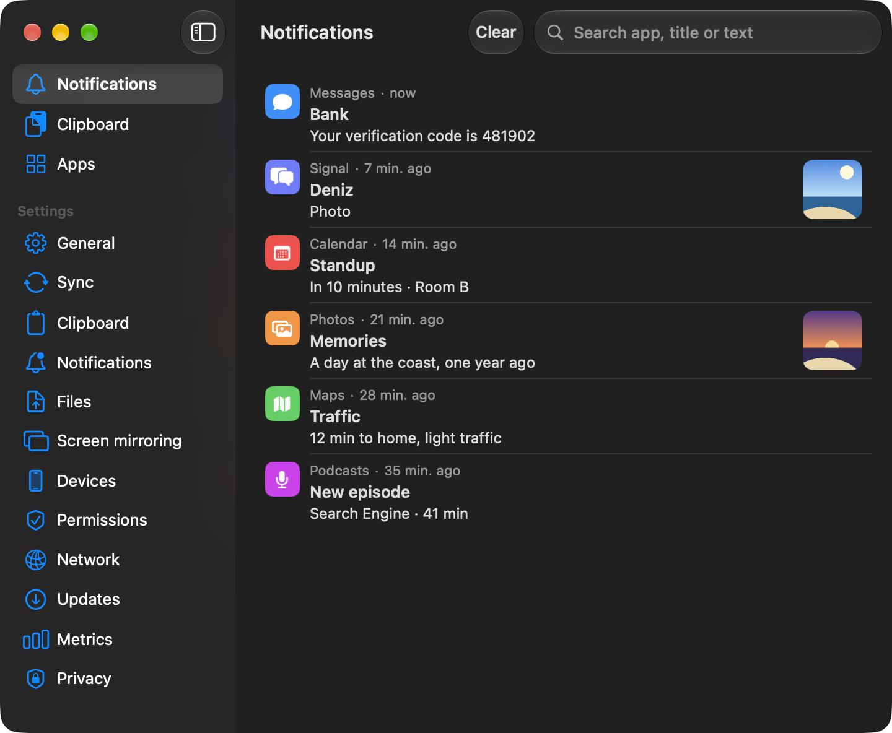</td>
</tr>
<tr>
<td colspan="4" align="center">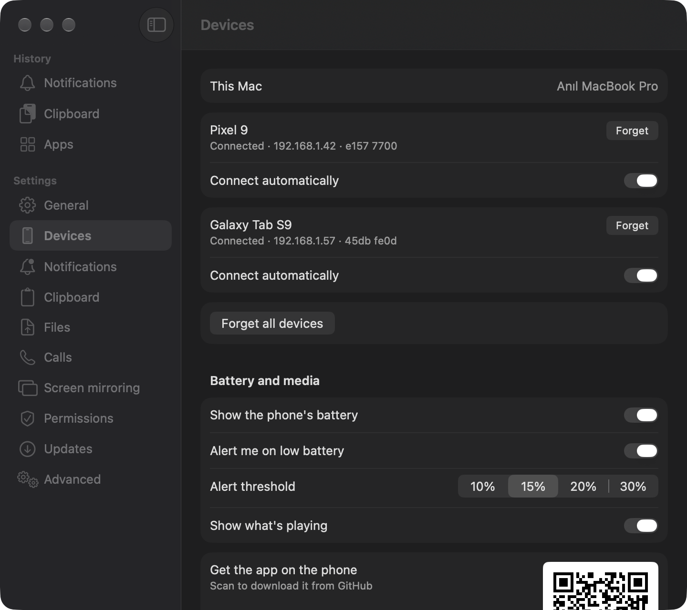</td>
</tr>
<tr>
<td colspan="4" align="center">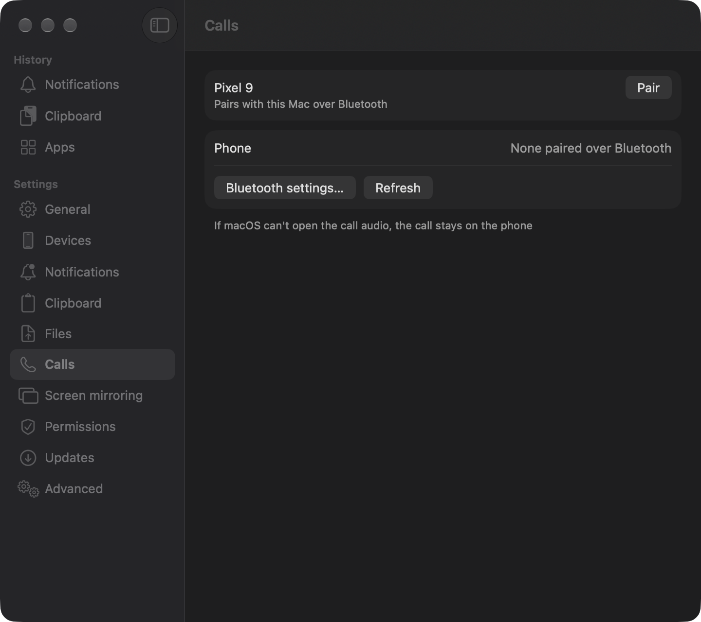</td>
</tr>
</table>

## Building and contributing

[CONTRIBUTING.md](../CONTRIBUTING.md) has the toolchain, the build, the tests, the repository
layout and how to add a language. [RELEASING.md](RELEASING.md) describes the release pipeline,
[PROTOCOL.md](PROTOCOL.md) the network protocol and [ENERGY.md](ENERGY.md) the battery rules.

Licensed under the [MIT License](../LICENSE).
